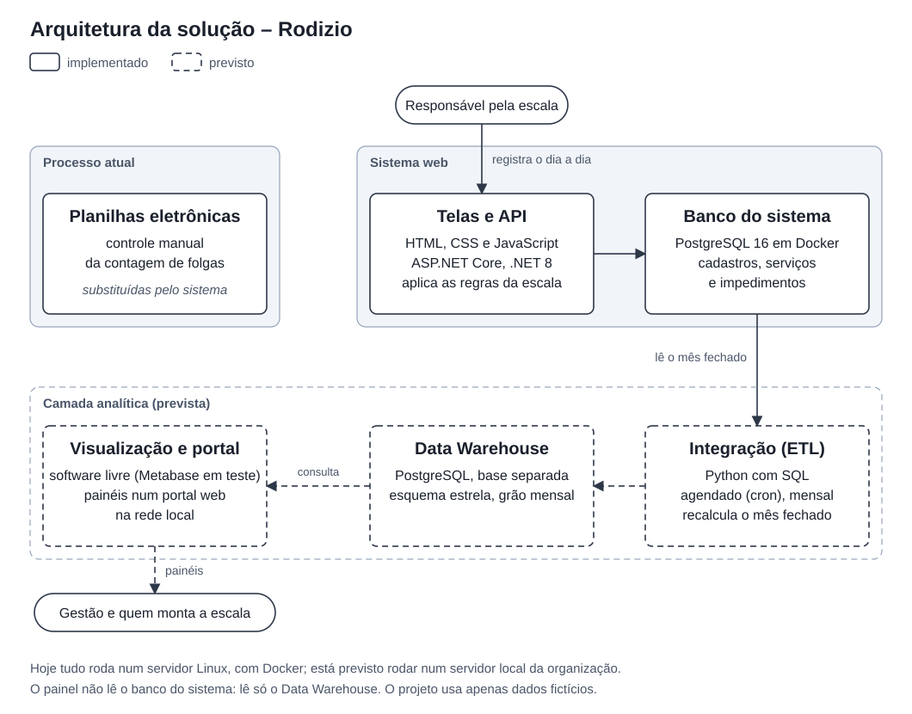

# Rodizio: gestão de escalas de serviço

API REST em C# com .NET 8, PostgreSQL e Docker que substitui planilhas na montagem das escalas de serviço de uma equipe de segurança patrimonial. O núcleo é uma lista de prioridade automática: para cada escala e cada data, o sistema calcula quem deve cumprir o próximo serviço.

> Versão de portfólio de um sistema que desenvolvi sozinho, de agosto a outubro de 2026, num projeto de extensão universitário com uma empresa parceira. O repositório original é privado por confidencialidade. Aqui, a organização (**Organização Exemplo**), as escalas (A a F), os nomes, os cargos e os dados são fictícios.

## Destaques

**Regras de negócio**
- Lista de prioridade automática: quem está há mais tempo sem serviço vem primeiro, com contagem separada para dias úteis e para fins de semana e feriados, e desempate por antiguidade.
- Descanso mínimo entre serviços, impedimentos (como atestados e viagens a serviço) e dias permitidos por pessoa.
- Trocas e cancelamentos sem apagar registros: o histórico de quem estava escalado é preservado.
- Tela com a situação do dia e alertas.

**Back-end e dados**
- API REST em ASP.NET Core (.NET 8), documentada com Swagger.
- Entity Framework Core 8 (code-first), com migrations aplicadas automaticamente ao iniciar.
- PostgreSQL 16 e 5 telas em HTML, CSS e JavaScript puro, servidas pela própria API.
- Modelo dimensional de Data Warehouse (esquema estrela, 2 tabelas fato e 5 dimensões, grão mensal), com metadados no próprio banco (`COMMENT ON`) e relatório gerado a partir do catálogo.

**Infraestrutura**
- Tudo sobe com um comando (Docker Compose): API, banco do sistema e Data Warehouse, criado automaticamente.
- Dockerfile multi-stage e a API rodando com usuário sem privilégios.
- Healthcheck no banco: a API só sobe quando ele está pronto.
- Portas presas em `127.0.0.1` e configuráveis pelo `.env`; credenciais fora do repositório.

**Engenharia**
- Requisitos levantados em entrevista com o usuário do processo.
- 74 decisões técnicas registradas, com data e motivo ([`docs/decisoes.md`](docs/decisoes.md)).
- Roteiro com 34 casos de teste e gerador de dados de demonstração.

## Arquitetura



Componentes, ambiente de execução e rotas da API em [`docs/arquitetura.md`](docs/arquitetura.md).

## Como executar

Pré-requisito: Docker com o plugin Compose.

```bash
git clone https://github.com/luizz-costa/rodizio-escalas.git
cd rodizio-escalas
cp .env.example .env              # defina uma senha no .env
docker compose up -d --build
```

As telas abrem em `http://localhost:5001`. Para carregar dados de demonstração:

```bash
docker compose run --rm api-rodizio --demo
```

As portas ficam sempre em `127.0.0.1` e podem ser trocadas no `.env` (`API_PORT`, padrão 5001, e `DB_PORT`, padrão 5432), por exemplo para rodar ao lado de outro projeto. Passo a passo completo e solução de problemas em [`docs/execucao.md`](docs/execucao.md).

## Documentação

- [`arquitetura.md`](docs/arquitetura.md): diagrama, componentes, ambiente e rotas da API.
- [`modelo-de-dados.md`](docs/modelo-de-dados.md): banco do sistema, modelo dimensional e dicionário de dados.
- [`relatorio-metadados.md`](docs/relatorio-metadados.md): metadados do Data Warehouse, gerados pelo PostgreSQL.
- [`funcionamento.md`](docs/funcionamento.md): como o sistema é usado no dia a dia.
- [`execucao.md`](docs/execucao.md): como executar do zero.
- [`decisoes.md`](docs/decisoes.md): decisões técnicas e o motivo de cada uma.
- [`roteiro-testes-mvp.md`](docs/roteiro-testes-mvp.md): roteiro de testes do MVP.
- [`src/README.md`](src/README.md): mapa das pastas do código.

## Próximos passos

- Testes automatizados com xUnit, a partir do roteiro de 34 casos.
- Autenticação com JWT.
- Integração contínua com GitHub Actions (build e testes a cada push).
- Healthcheck também na API.
- Carga mensal (ETL) para o Data Warehouse e painéis de indicadores de absenteísmo e efetivo.

## Autor

**Luiz Felipe Alves Costa**, estudante de Sistemas de Informação na PUC Minas.
[LinkedIn](https://www.linkedin.com/in/luizz-costa/) · [Portfólio](https://luizz-costa.github.io/) · [GitHub](https://github.com/luizz-costa)
