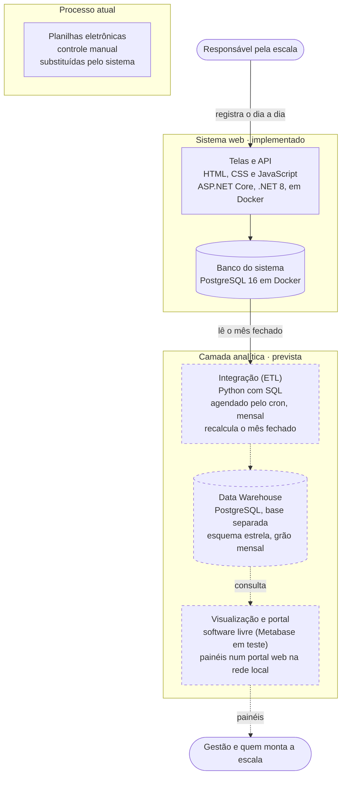

# Arquitetura

A solução tem duas partes. O **sistema web**, já implementado, é onde o responsável pela escala da Organização Exemplo registra o dia a dia. A **camada analítica** (integração, Data Warehouse e visualização), prevista, lê os dados do sistema e gera os painéis para a gestão. O painel nunca lê o banco do sistema diretamente: lê só o Data Warehouse.

| Marca | Significado |
| --- | --- |
| Sem marca | Existe e foi conferido no código |
| `[PREVISTO]` | Planejado; ainda não existe |
| `[A DEFINIR]` | Ainda não escolhido |

## Visão geral

Linhas e caixas tracejadas = previsto. As planilhas aparecem como o processo que o sistema substitui: não há importação delas (ver passo 2 abaixo). A mesma figura, como imagem, está em [`img/arquitetura.svg`](../img/arquitetura.svg).

## Como os dados percorrem a solução

1. **Processo atual.** Sem o sistema, as escalas são controladas em planilhas eletrônicas, com a contagem de folgas feita à mão. O sistema web substitui essas planilhas.
2. **Ponto de partida dos dados.** As planilhas não são importadas: importar exigiria ler formatações e fórmulas, tratar duplicidades e completar informações que a planilha não tem (como o motivo do impedimento), e o projeto trabalha só com dados fictícios. No projeto, o banco é preenchido por um gerador de dados fictícios (`dotnet run -- --demo`, D-40 e D-41). Numa implantação real, o ponto de partida seria o cadastro das pessoas, e do último serviço de cada uma, pelas próprias telas, que aceitam lançamentos em datas passadas (D-50).
3. **Registro diário.** O responsável pela escala usa as telas para cadastrar funcionários e feriados, registrar impedimentos e montar a escala. A API aplica as regras (fila do dia, "há mais tempo sem serviço", proibição de dobrar, impedimentos, dias permitidos) e grava no banco do sistema.
4. **Integração** `[PREVISTO]`. Um script em Python, agendado pelo cron do servidor para rodar no primeiro dia de cada mês, lê do banco do sistema os serviços e impedimentos do mês anterior, já fechado, e grava no Data Warehouse os totais do mês, com as transformações feitas em SQL. Para carregar um mês, o script apaga as linhas daquele mês e grava de novo; assim, se alguém corrigir um lançamento depois, basta rodar a carga daquele mês outra vez, sem duplicar dados (D-70). O script terá uma tabela de controle das cargas, registrará um log de cada execução e lerá o banco do sistema com um usuário só de leitura.
5. **Data Warehouse** `[PREVISTO]`. Fica fisicamente no PostgreSQL, numa base separada do banco do sistema, no modelo dimensional em esquema estrela, com grão mensal, descrito em [`modelo-de-dados.md`](modelo-de-dados.md). A estrutura já está criada e testada ([`db/modelo-dimensional.sql`](../db/modelo-dimensional.sql)).
6. **Visualização e portal** `[PREVISTO]`. Uma ferramenta busca os dados do Data Warehouse e monta os painéis. Critérios de escolha: software livre e sem custo de licença, rodar no servidor local e permitir drill up, drill down e cruzamento de dados. Candidata em avaliação: Metabase. Ferramenta final: `[A DEFINIR]`. Os painéis ficam num portal web na rede local da organização, separado das telas do sistema, acessado pelo navegador pela gestão e por quem monta a escala (D-73).

## Componentes

| Componente | Responsabilidade | Tecnologia | Situação |
| --- | --- | --- | --- |
| Telas | Cadastro, montagem da escala e situação do dia (5 telas) | HTML, CSS e JavaScript, sem framework, servidos pela própria API (D-19, D-42) | Implementado |
| API | Regras de negócio, validações e acesso ao banco | C#, ASP.NET Core (.NET 8), Entity Framework Core 8 com migrations aplicadas ao iniciar, Swagger; em container Docker (D-74) | Implementado |
| Banco do sistema | Cadastros e eventos (serviços e impedimentos) | PostgreSQL 16 em container Docker | Implementado |
| Gerador de dados fictícios | Preenche o banco para teste e demonstração (`docker compose run --rm api-rodizio --demo`) | C#, na própria API (D-40, D-41) | Implementado |
| Carga a partir das planilhas | — | — | Fora do escopo: o projeto usa só dados fictícios |
| Integração (ETL) | Ler o banco do sistema, transformar e carregar o DW, uma vez por mês | Script em Python com transformações em SQL, agendado pelo cron | `[PREVISTO]` |
| Data Warehouse | Guardar o histórico organizado para análise, em grão mensal | PostgreSQL, base separada (`rodizio_dw`), no mesmo container do banco do sistema | Estrutura criada automaticamente na primeira subida do Docker (D-74); carga `[PREVISTO]` |
| Visualização e portal | Painéis interativos para a gestão e para quem monta a escala, num portal web na rede local | Software livre, a definir | `[PREVISTO]` |

## Ambiente de execução

- **Hoje:** tudo roda num servidor Linux, com Docker Compose (D-74). O `docker-compose.yml` define dois containers: `postgres-rodizio` (imagem `postgres:16`, porta 5432, volume `rodizio_db_data`, limite de 512 MB de memória), com o banco do sistema e o Data Warehouse, e `api-rodizio` (imagem compilada pelo `Dockerfile` da API, porta 5001, limite de 384 MB), que entrega a API e as telas (`/`). As portas só aceitam conexões do próprio servidor (`127.0.0.1`). Na primeira subida, o Data Warehouse é criado pelo script `db/init/01-cria-dw.sh`; a API aplica as migrations ao iniciar e só sobe depois que o banco responde. Medido em 12/10/2026: os dois containers usam menos de 100 MB de memória. Para depurar, a API também roda fora do Docker, com `dotnet run`. Como executar: [`execucao.md`](execucao.md).
- **Previsto:** implantação num servidor local da organização. Sistema operacional e recursos: `[A DEFINIR]`. Se o servidor for Windows, o agendamento do ETL usa o Agendador de Tarefas no lugar do cron; o script é o mesmo.

## Segurança e dados

- Credenciais fora do repositório: usuário, senha e nome do banco ficam num arquivo `.env`, que o `.gitignore` exclui; no Docker, a connection string da API é montada a partir dele, e, fora do Docker, fica no .NET User Secrets. O `appsettings.json` versionado não tem senha, e o `.dockerignore` impede que um `.env` entre na imagem.
- A API roda no container com um usuário sem privilégios de administrador.
- Somente dados fictícios: nenhum nome, matrícula ou dado real de funcionário entra no sistema, no repositório ou nos painéis.
- Nenhum recurso externo (CDN, fontes online): o sistema funciona em rede restrita e não chama servidores de terceiros (D-43).
- Todo dado vindo da API é escapado antes de entrar no HTML, contra XSS (D-44).
- Limitação conhecida: não há login nem perfis de acesso.

## Rotas da API

| Recurso | Rotas | Para quê |
| --- | --- | --- |
| Funcionários | `GET /api/Funcionarios` (filtro `escalaId`), `GET /{id}`, `POST`, `PUT /{id}`, `PATCH /{id}/desativar`, `PATCH /{id}/reativar` | Cadastro; sem exclusão física |
| Escalas | `GET /api/Escalas`, `GET /{id}`, `GET /{id}/prioridade?data=` | As 6 escalas e a lista de prioridade de uma data |
| Dias especiais | `GET /api/DiasEspeciais`, `GET /{id}`, `POST`, `DELETE /{id}` | Feriados e folgas coletivas; só datas futuras podem ser removidas |
| Impedimentos | `GET /api/Impedimentos` (filtros `ativosEm`, `funcionarioId`), `GET /{id}`, `POST`, `PUT /{id}`, `PATCH /{id}/encerrar`, `PATCH /{id}/cancelar` | Atestado médico e viagem a serviço |
| Serviços | `GET /api/Servicos` (filtros `data`, `escalaId`, `funcionarioId`, `incluirCancelados`), `GET /{id}`, `POST`, `PUT /{id}/troca`, `PATCH /{id}/cancelar` | Escalar, trocar e cancelar sem apagar |
| Situação do dia | `GET /api/Situacao?data=` | Totais, quadros por escala e alertas da tela inicial |
| Postos | `GET /api/Postos`, `GET /{id}`, `POST`, `PUT /{id}`, `PATCH /{id}/desativar`, `PATCH /{id}/reativar` | Fora do escopo do MVP: o sistema não registra o posto de cada pessoa |

## Decisões relacionadas

Em [`decisoes.md`](decisoes.md): D-70 (carga mensal), D-73 (portal), D-16 (registro por eventos), D-18 (classe da lista de prioridade), D-19 e D-42 (telas servidas pela API), D-25 (formato dos erros), D-27 (datas de criação e alteração para a carga incremental), D-43 (nenhum recurso externo), D-44 (proteção contra XSS) e D-74 (execução com Docker Compose).
