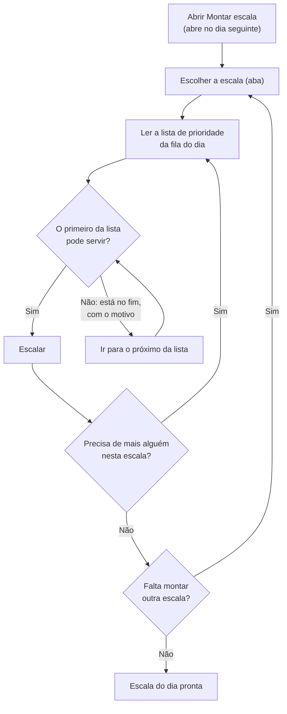
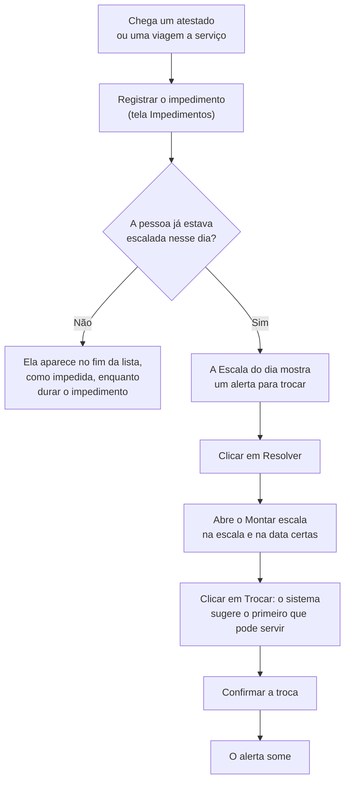

# Funcionamento

Como o responsável pela escala da Organização Exemplo usa o sistema no dia a dia: o que muda em relação ao controle em planilha, o caminho de cada tarefa e para que serve cada tela. A parte técnica está em [`arquitetura.md`](arquitetura.md), e o motivo de cada regra, em [`decisoes.md`](decisoes.md).

| Marca | Significado |
| --- | --- |
| Sem marca | Existe e foi conferido no código e no roteiro de testes |
| `[PREVISTO]` | Planejado; ainda não existe |

## Conceitos

- **Escala:** um grupo de pessoas que se revezam num mesmo tipo de serviço. A Organização Exemplo tem seis: Escala A a Escala F.
- **Serviço:** uma pessoa escalada numa data, numa escala. Ninguém cumpre serviço em dois dias seguidos ("dobrar").
- **Fila do dia:** dias úteis formam a **fila de dias úteis**; sábados, domingos e dias especiais (feriados e folgas coletivas), a **fila de fins de semana e feriados**. Cada fila tem sua própria contagem de folgas.
- **Há mais tempo sem serviço:** é o critério da prioridade. Quem está há mais tempo sem cumprir serviço na fila do dia vem primeiro. No empate, decide a antiguidade.
- **Impedimento:** período em que a pessoa não pode cumprir serviço (atestado médico ou viagem a serviço).

## Antes e agora

| Tarefa | Na planilha | No sistema |
| --- | --- | --- |
| Saber quem é o próximo a cumprir serviço | Contar à mão os dias sem serviço de cada pessoa, na fila do dia | A tela Montar escala mostra a lista de prioridade já calculada: quem está há mais tempo sem serviço primeiro e, no empate, a antiguidade |
| Saber quem não pode | Marcações e observações soltas na planilha, e atenção para não dobrar | Quem não pode aparece no fim da lista, com o motivo: impedido, cumpriu serviço no dia anterior, dia não permitido, já escalado. O sistema não deixa escalar essas pessoas |
| Feriado ou folga coletiva | Marcar o dia à mão | Cadastrar o dia especial: a fila do dia muda sozinha para a de fins de semana e feriados |
| Atestado ou viagem a serviço | Marcar à mão os dias afetados | Registrar o impedimento, com motivo, início e fim |
| Troca de serviço | Anotar à parte | Botão "Trocar": o serviço passa para o substituto, e quem estava escalado fica guardado |
| Lançamento errado | Apagar ou corrigir a célula | Botão "Desfazer": o serviço é cancelado sem ser apagado |
| Ver a situação do dia | Abrir cada escala, uma por uma | Tela Escala do dia: totais, um quadro por escala e alertas |
| Informar a gestão | Enviar a planilha | Painéis de BI `[PREVISTO]` |

## O dia a dia

### Montar a escala

A escala é montada com antecedência; por isso a tela abre no dia seguinte. Escalas de vários dias, como as do fim de semana, podem ser montadas de uma vez, em qualquer ordem.

Depois de cada ação, a lista é recalculada: quem foi escalado vai para a coluna de escalados e para o fim da lista, com "Já está escalado nesta data". Quantas pessoas escalar em cada escala é decisão do responsável; o sistema não fixa um número.

### Alteração de última hora

Quando alguém que já estava escalado recebe um atestado ou sai em viagem a serviço:

O sistema aceita um impedimento sobre um serviço já lançado, porque o atestado chega quando chega, e avisa que é preciso trocar. A escolha do substituto continua com o responsável: o sistema sugere, não decide.

## As telas

São 5 telas, com o mesmo menu no topo. O cabeçalho mostra sempre "Organização Exemplo · dados fictícios".

| Tela | Para quê | O que dá para fazer |
| --- | --- | --- |
| **Escala do dia** (tela inicial) | Ver como está um dia | Escolher a data (padrão: hoje) e navegar dia a dia; ver a fila do dia; os totais (ativos nas escalas, de serviço, impedidos e disponíveis, que são os ativos menos os impedidos); um quadro por escala com os escalados e os impedidos; os alertas de escalado impedido, com o atalho "Resolver" |
| **Montar escala** | Escalar | Abre no dia seguinte; uma aba por escala; navegar dia a dia; lista de prioridade com posição, dias sem serviço e antiguidade; quem não pode aparece no fim, com o motivo; Escalar, Trocar e Desfazer. Em datas passadas, um aviso lembra que o lançamento altera o histórico |
| **Funcionários** | Manter o cadastro | Listar, com filtro por escala; cadastrar e editar (nome, matrícula, cargo, escala, antiguidade e dias em que pode servir); desativar e reativar, sem apagar |
| **Impedimentos** | Registrar quem está fora | Registrar atestado médico ou viagem a serviço, com início e fim (o fim pode ficar em aberto); corrigir; encerrar; cancelar um lançado por engano. A lista mostra os ativos na data, ou todos, inclusive os cancelados |
| **Dias especiais** | Registrar feriados e folgas coletivas | Cadastrar data e descrição; remover só datas futuras, porque as passadas já fazem parte do histórico |

As telas mostram as mensagens de erro da API junto do campo com problema. Exemplo: "Escala não informada ou inexistente." embaixo do campo Escala.

## O que o sistema não faz

- **Não escolhe sozinho quem cumpre o serviço.** Ele ordena os candidatos e bloqueia quem não pode; a decisão é do responsável.
- **Não registra o posto de cada pessoa.** O cadastro de postos existe, mas fica fora do fluxo da escala, por estar fora do escopo do MVP.
- **Não registra férias nem falta sem aviso.** Hoje os impedimentos são atestado médico e viagem a serviço; novos motivos podem ser acrescentados sem mudar o banco.
- **Não tem login nem perfis de acesso.**
- **Não importa planilhas.** O projeto trabalha só com dados fictícios, gerados pelo próprio sistema.
- **Não mostra painéis de gestão ainda.** Data Warehouse e painéis estão previstos (ver [`arquitetura.md`](arquitetura.md)).
