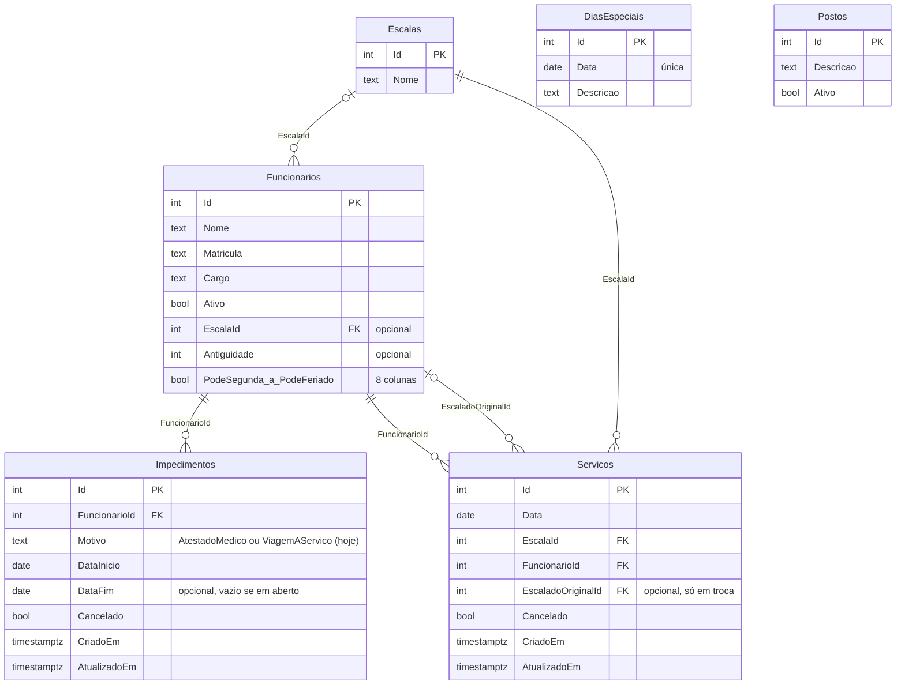
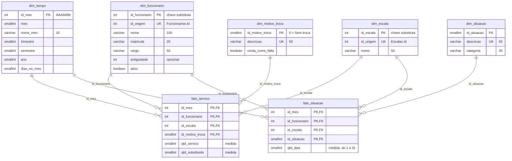

# Modelo de dados

A solução tem dois bancos, os dois em PostgreSQL. O **banco do sistema** (relacional) guarda o dia a dia registrado pelas telas e já está implementado. O **Data Warehouse** (dimensional) organiza esses dados para os painéis. O modelo dimensional só usa o que o banco do sistema registra ou o que a integração (ETL) consegue calcular a partir dele.

| Marca | Significado |
| --- | --- |
| Sem marca | Existe e foi conferido no código, ou foi testado no PostgreSQL |
| `[PREVISTO]` | Planejado; ainda não existe |
| `[A DEFINIR]` | Ainda não escolhido |

## 1. Banco do sistema (relacional)

Criado pela migration `InitialCreate` do Entity Framework Core (`src/Rodizio.Api/Data/Migrations`). O diagrama abaixo foi montado a partir do snapshot das migrations.

| Tabela | O que guarda | Regras no banco |
| --- | --- | --- |
| `Escalas` | As 6 escalas de serviço (Escala A a Escala F), criadas pela migration com ids fixos (1 a 6) | — |
| `Funcionarios` | Cadastro das pessoas (dados fictícios no projeto), escala atual, antiguidade e dias em que podem servir (8 colunas, de segunda a domingo e feriado, D-22) | Exclusão lógica pelo campo `Ativo`. `EscalaId` é opcional no banco, mas a API exige uma escala (D-20) |
| `Impedimentos` | Atestado médico e viagem a serviço, com início e fim (o fim é o último dia impedido, D-48) | O motivo é gravado como texto (D-26); cancelamento lógico pelo campo `Cancelado` |
| `Servicos` | Cada serviço: dia, escala, quem cumpriu e, se houve troca, quem estava escalado antes (D-31, D-34) | Índice único parcial: no máximo um serviço não cancelado por pessoa por dia (D-32). Cancelar não apaga o registro |
| `DiasEspeciais` | Feriados e folgas coletivas, que mudam a fila do dia | Índice único na data (D-24) |
| `Postos` | Cadastro de postos | Fora do escopo do MVP: o posto de cada pessoa não é registrado. Não entra no Data Warehouse |

Todas as chaves estrangeiras usam `Restrict`: o banco não deixa apagar um registro que outro use. `CriadoEm` e `AtualizadoEm` ficam em UTC e são preenchidos pela API; servem para a carga incremental (D-27). `Funcionarios`, `Escalas` e `DiasEspeciais` não têm esses campos e são lidas inteiras a cada carga (são tabelas pequenas).

## 2. Data Warehouse (modelo dimensional)

`[PREVISTO]` para a carga. A estrutura está pronta e testada no PostgreSQL 16: [`db/modelo-dimensional.sql`](../db/modelo-dimensional.sql).

Fatos e dimensões, com as chaves primárias (PK), estrangeiras (FK) e únicas (UK). Os números entre aspas nas colunas `varchar` são o tamanho máximo. O mesmo modelo, no formato do DbDesigner (erd.dbdesigner.net), está em [`db/modelo-dimensional-dbdesigner.sql`](../db/modelo-dimensional-dbdesigner.sql).

**Mudanças previstas no sistema** `[PREVISTO]`. O modelo dimensional usa duas informações que o banco do sistema ainda não registra:
- **Motivo da troca** em `Servicos`: atestado médico, viagem a serviço, não compareceu, troca combinada ou férias, licença ou curso. Hoje o sistema guarda quem estava escalado, mas não o motivo.
- **Novos motivos de impedimento** em `Impedimentos`: férias, licença e curso.

### Esquema estrela

O modelo é um **esquema estrela**. São duas tabelas fato que compartilham as dimensões de tempo, funcionário e escala; cada fato tem ainda uma dimensão própria. Juntas, formam uma constelação de fatos.

Escolhemos a estrela em vez do floco de neve (*snowflake*). O floco de neve normaliza as dimensões, por exemplo separando trimestre e ano da `dim_tempo` em tabelas próprias: reduz a repetição, mas aumenta o número de tabelas e de junções em cada consulta. O volume aqui é pequeno, então a repetição da estrela custa pouco, e as consultas e os painéis ficam mais simples.

### As fatos e o grão

| Fato | Grão (o que uma linha representa) | Medidas | Chave primária |
| --- | --- | --- | --- |
| `fato_servico` | Os serviços de um funcionário, numa escala, num mês, por motivo de troca | `qtd_servico` e `qtd_substituido` | (`id_mes`, `id_funcionario`, `id_escala`, `id_motivo_troca`) |
| `fato_situacao` | Os dias de um funcionário, numa escala, num mês, em cada situação | `qtd_dias` | (`id_mes`, `id_funcionario`, `id_escala`, `id_situacao`) |

**Grão mensal.** O grão do tempo é o **mês**. No grão diário, cada linha teria quantidade 1, e a medida não diria nada. No mês, as medidas passam a ter sentido: quantos serviços, quantas trocas e quantos dias em cada situação. Os totais do mês continuam agregáveis por trimestre, semestre e ano. A situação de cada dia continua visível em tempo real na tela "Escala do dia" do sistema.

**Chave primária composta.** As fatos não têm um id próprio: a chave é o conjunto das chaves das dimensões. Todas as chaves estrangeiras da fato fazem parte da chave primária.

**Drill up e drill down.** Os totais sobem pela hierarquia da `dim_tempo`: mês → trimestre → semestre → ano. É assim que a frequência de faltas é analisada por mês e por ano.

**Medidas da `fato_servico`.**
- `qtd_servico`: serviços que o funcionário **cumpriu**. Na linha com motivo "Sem troca", são os serviços normais. Nas outras linhas, são serviços que ele cumpriu **no lugar de outra pessoa**, por aquele motivo.
- `qtd_substituido`: vezes em que o funcionário **estava escalado e foi trocado**, por aquele motivo.

Exemplo, com dados fictícios: em outubro, na Escala E, o Func. 001 cumpriu 8 serviços normais e foi trocado 1 vez por atestado médico; o Func. 002 cumpriu o serviço no lugar dele. As linhas são:

| id_mes | Funcionário | Escala | Motivo | qtd_servico | qtd_substituido |
| --- | --- | --- | --- | --- | --- |
| 202610 | Func. 001 | Escala E | Sem troca | 8 | 0 |
| 202610 | Func. 001 | Escala E | Atestado médico | 0 | 1 |
| 202610 | Func. 002 | Escala E | Atestado médico | 1 | 0 |

Assim, quem cumpriu o serviço e quem foi trocado ficam registrados na própria linha de cada um, sem uma segunda referência ao funcionário na mesma fato.

### Dimensões

| Dimensão | Uma linha por | Observação |
| --- | --- | --- |
| `dim_tempo` | Mês | Meses de 2026 a 2030, gerados pelo script. Hierarquia mês, trimestre, semestre e ano. `dias_no_mes` serve para as médias do efetivo |
| `dim_funcionario` | Funcionário | Dados atuais, sem histórico de versões: a escala de cada mês fica gravada na própria fato. `ativo` indica se a pessoa ainda é funcionária, isto é, não foi desativada no sistema |
| `dim_escala` | Escala | As 6 escalas. O posto não entra: está fora do escopo do MVP, e o sistema não o registra |
| `dim_situacao` | Situação possível de uma pessoa num dia | Lista fixa de 8 situações, calculada pelo ETL dia a dia e somada no mês |
| `dim_motivo_troca` | Motivo de troca | Lista fixa de 6 motivos, com a marca `conta_como_falta` |

### Situações

O ETL aplica estas regras, na ordem, para cada funcionário ativo com escala, em cada dia do mês, e grava na `fato_situacao` quantos dias a pessoa passou em cada situação. São as mesmas regras da tela "Escala do dia" (`GET /api/Situacao`).

| id | Descrição | Categoria | Regra |
| --- | --- | --- | --- |
| 1 | Em serviço | Em serviço | Tem serviço não cancelado no dia e não está impedido |
| 2 | Impedido – Atestado médico | Impedido | Impedimento não cancelado que cobre o dia, por atestado médico, sem serviço no dia |
| 3 | Impedido – Viagem a serviço | Impedido | Idem, por viagem a serviço |
| 4 | Impedido – Férias | Impedido | Idem, por férias `[PREVISTO]` |
| 5 | Impedido – Licença | Impedido | Idem, por licença `[PREVISTO]` |
| 6 | Impedido – Curso | Impedido | Idem, por curso `[PREVISTO]` |
| 7 | Escalado e impedido | Alerta | Tem serviço e impedimento no mesmo dia (precisava de troca e ela não foi feita) |
| 8 | Livre | Livre | Sem serviço e sem impedimento no dia |

Um impedimento "cobre o dia" quando a data está entre `DataInicio` e `DataFim`, inclusive, ou quando `DataFim` está vazia.

### Motivos de troca

| id | Descrição | Conta como falta |
| --- | --- | --- |
| 0 | Sem troca (serviço normal) | Não |
| 1 | Atestado médico | Sim |
| 2 | Viagem a serviço | Sim |
| 3 | Não compareceu | Sim |
| 4 | Troca combinada | Não |
| 5 | Férias, licença ou curso | Não |

Falta é o escalado que não cumpriu o serviço por atestado médico, viagem a serviço ou não comparecimento. A troca combinada entre as pessoas não é falta. Férias, licença e curso são afastamentos planejados e também não contam. Para mudar o critério, basta mudar a marca `conta_como_falta`, sem alterar a estrutura.

### Métricas

| Métrica | Definição | Como sai do modelo |
| --- | --- | --- |
| Absenteísmo (frequência de faltas) | Faltas ÷ serviços previstos × 100 | **Faltas** = soma de `qtd_substituido` nos motivos que contam como falta. **Previstos** = soma de `qtd_servico` com motivo "Sem troca" + soma de `qtd_substituido`. Por mês, trimestre, semestre ou ano, por escala ou por funcionário |
| Efetivo atual | Pessoas de serviço, por escala | Média do mês: dias nas categorias Em serviço e Alerta ÷ `dias_no_mes`. O efetivo de um dia específico aparece na tela "Escala do dia" |
| Efetivo disponível | Todos da escala menos os impedidos | Média do mês: dias fora das categorias Impedido e Alerta ÷ `dias_no_mes` |
| Trocas | — | Soma de `qtd_substituido`, por motivo |

O cálculo do absenteísmo e do efetivo foi testado no PostgreSQL 16 com dados fictícios: 25 serviços previstos e 1 falta deram 4,0%, e a conta fechou por escala e por funcionário.

Horas trabalhadas não entra no modelo: não está entre as métricas acompanhadas. Se for pedida, o cálculo é a quantidade de serviços × a duração do turno.

### O que mudou em relação às versões anteriores

| Antes | Agora (v3) | Motivo |
| --- | --- | --- |
| `id_fato_servico` e `id_fato_situacao` | Chave composta pelas chaves das dimensões | Toda fato identificada pelas suas dimensões |
| `dim_data`, um dia por linha | `dim_tempo`, um mês por linha | No dia, a quantidade seria sempre 1 |
| `fato_situacao_diaria`, com `qtd` sempre 1 | `fato_situacao`, com `qtd_dias` no mês | Grão mensal |
| `id_funcionario_original` e `foi_troca` na `fato_servico` | `id_motivo_troca` na chave e medida `qtd_substituido` | Quem foi trocado passa a ser contado na própria linha, com o motivo na chave |
| Sem motivo da troca | `dim_motivo_troca` | Calcular as faltas pelo motivo da troca |
| 5 situações | 8 situações, com férias, licença e curso | Cobrir os afastamentos planejados |
| `cancelado` na `fato_servico` | Só serviços válidos | Cancelamentos não entram nos painéis |
| `vigencia_inicio`, `vigencia_fim` e `versao_atual` na `dim_funcionario` | `ativo`, sem histórico de versões | Simplifica o ETL; a escala de cada mês já fica na fato |

## 3. Metadados

O relatório completo de metadados (nome, tipo, se aceita vazio, chave primária, chave estrangeira e descrição de cada coluna) é gerado pelo próprio PostgreSQL: as descrições ficam gravadas no banco com `COMMENT ON`, e [`db/relatorio-metadados.sql`](../db/relatorio-metadados.sql) lê o catálogo e monta a tabela. O resultado está em [`relatorio-metadados.md`](relatorio-metadados.md).

As tabelas abaixo completam o relatório com a **origem** de cada coluna no banco do sistema e a **regra no ETL**. Uma coluna sem origem não pode entrar no modelo sem antes mudar o sistema.

### `dim_tempo`

| Coluna | Origem | Regra no ETL |
| --- | --- | --- |
| `id_mes`, `mes`, `nome_mes`, `trimestre`, `semestre`, `ano`, `dias_no_mes` | Calendário | Gerados pelo script, de 2026 a 2030 |

### `dim_funcionario`

| Coluna | Origem | Regra no ETL |
| --- | --- | --- |
| `id_funcionario` | — | Gerada pelo banco |
| `id_origem` | `Funcionarios.Id` | Copia; liga a carga ao registro de origem |
| `nome`, `matricula`, `cargo`, `antiguidade`, `ativo` | `Funcionarios` (mesmos nomes) | Copia; atualiza se mudar |

O sistema não limita o tamanho dos textos. Um valor maior que a coluna faz a carga falhar, e o ETL deve registrar isso no log.

### `dim_escala`

| Coluna | Origem | Regra no ETL |
| --- | --- | --- |
| `id_escala` | — | Gerada pelo banco |
| `id_origem`, `nome` | `Escalas.Id`, `Escalas.Nome` | Copia |

### `dim_situacao` e `dim_motivo_troca`

Listas fixas, criadas pelo script. Não existem no banco do sistema.

### `fato_servico`

| Coluna | Origem | Regra no ETL |
| --- | --- | --- |
| `id_mes` | `Servicos.Data` | Mês da data, no formato AAAAMM |
| `id_funcionario` | `Servicos.FuncionarioId` e `Servicos.EscaladoOriginalId` | Quem cumpriu (para `qtd_servico`) e quem estava escalado (para `qtd_substituido`) |
| `id_escala` | `Servicos.EscalaId` | Troca pelo id da `dim_escala` |
| `id_motivo_troca` | Motivo da troca em `Servicos` `[PREVISTO]` | 0 (Sem troca) quando `EscaladoOriginalId` está vazio |
| `qtd_servico` | `Servicos` | Conta os serviços não cancelados de quem cumpriu |
| `qtd_substituido` | `Servicos.EscaladoOriginalId` | Conta os serviços não cancelados em que a pessoa era a escalada original |

### `fato_situacao`

| Coluna | Origem | Regra no ETL |
| --- | --- | --- |
| `id_mes` | Calendário | Mês carregado |
| `id_funcionario` | `Funcionarios.Id` | Funcionários ativos e com escala |
| `id_escala` | `Funcionarios.EscalaId` | O sistema guarda só a escala atual; a carga registra como estava no mês |
| `id_situacao` | `Servicos`, `Impedimentos` | Regras da tabela de situações, aplicadas dia a dia |
| `qtd_dias` | — | Conta os dias do mês em cada situação |

## 4. Regras de carga

`[PREVISTO]`. O script de integração está descrito em [`arquitetura.md`](arquitetura.md). Estas são as regras que o modelo exige dele:

1. **Carga mensal.** No primeiro dia de cada mês, o ETL carrega o mês anterior, já fechado.
2. **Reprocessamento.** Para carregar um mês, o ETL apaga as linhas daquele mês nas duas fatos e grava de novo a partir do banco do sistema. Assim, se alguém corrigir um lançamento depois, basta rodar a carga do mês outra vez, e rodar duas vezes não duplica dados.
3. **Dimensões.** A cada carga, o ETL lê `Funcionarios` e `Escalas` inteiras e insere o que é novo e atualiza o que mudou, pelo `id_origem`.
4. **Só serviços válidos.** Entram só os serviços com `Cancelado` falso.
5. **Limitação conhecida.** O sistema guarda só a escala atual de cada pessoa, sem histórico. Ao carregar um mês, o ETL usa a escala da pessoa naquele momento.

**Teste do script.** O `db/modelo-dimensional.sql` foi executado num PostgreSQL 16 com dados fictícios. Foram testados:
- a criação das 7 tabelas e dos 60 meses de 2026 a 2030, com fevereiro de 2028 corretamente com 29 dias;
- o cálculo do absenteísmo por escala e por funcionário e do efetivo médio;
- o drill up de mês para trimestre e ano;
- a recusa de linhas repetidas pela chave composta.

## 5. Pendências

| Pendência | Depende de |
| --- | --- |
| Registrar o motivo da troca e os novos motivos de impedimento no sistema | `[PREVISTO]` |
| Ferramenta de visualização | `[A DEFINIR]` |
